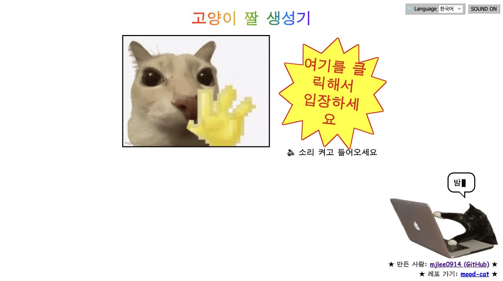
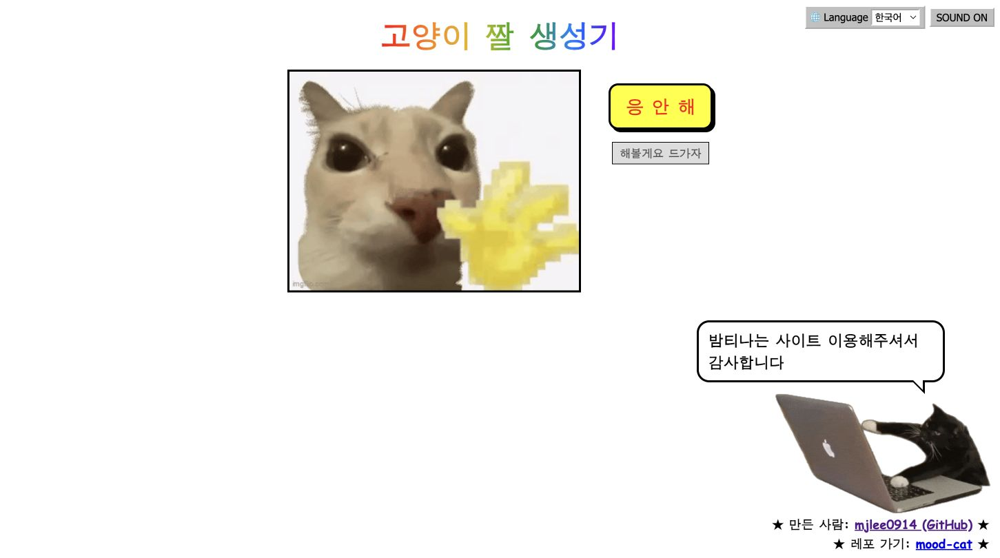
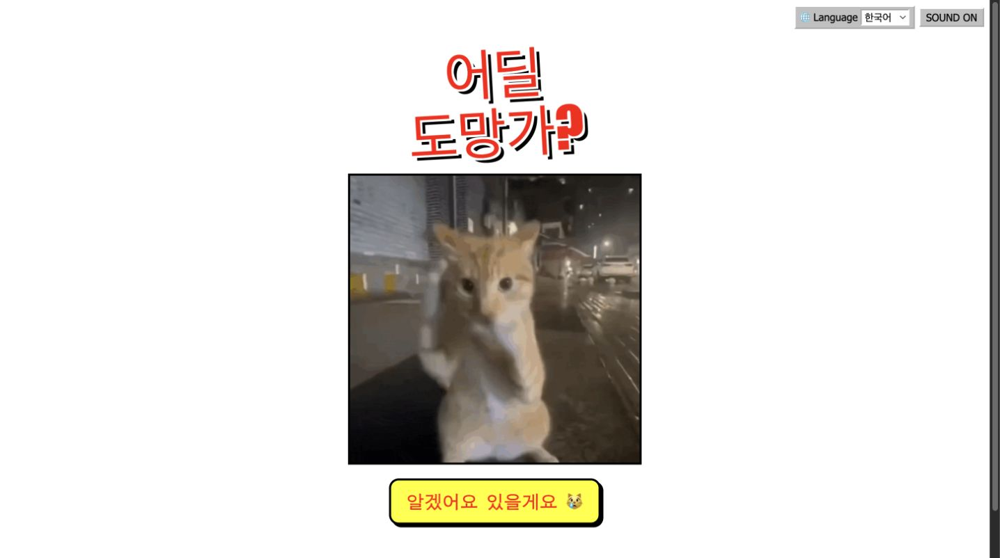
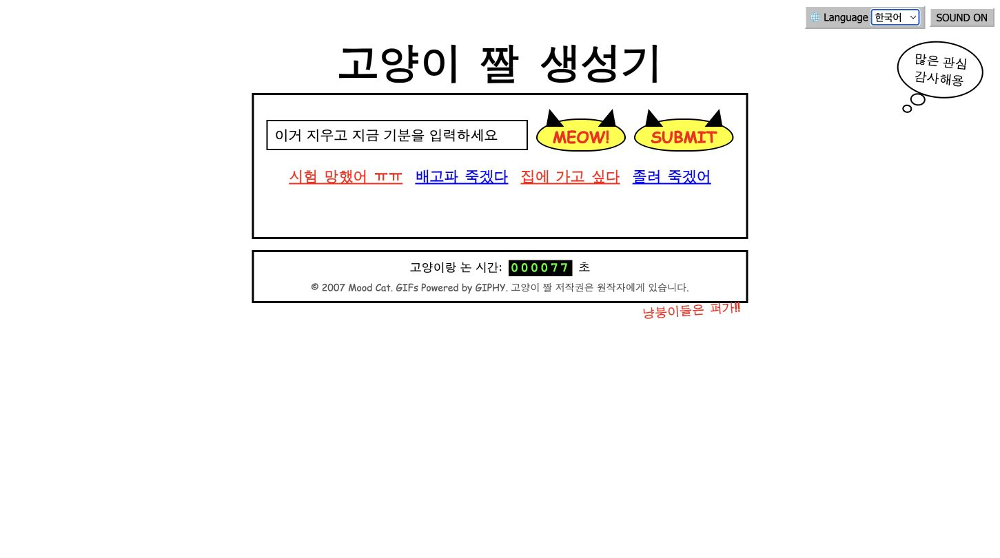
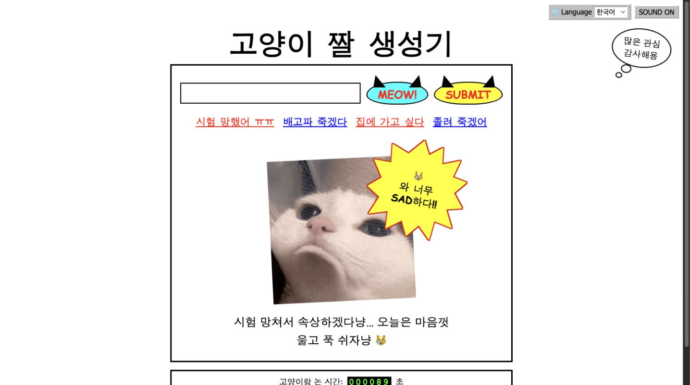

# Mood Cat 기능과 화면 구성

## 프로젝트 소개

[Mood Cat](https://mjlee0914.github.io/mood-cat/)은 사용자가 지금 기분이나 상태를 문장으로 입력하면 다음 결과를 보여 주는 미니 웹 앱이다.

```text
"시험 망했어 ㅠㅠ"
        ↓
감정 라벨: sad
        ↓
슬픈 고양이 GIF + 고양이 말투 캡션
```

LangChain Runnable과 LCEL을 수업에서 이론으로만 배웠을 때는 흐름이 잘 와닿지 않았다. 그래서 감정 분류, 캡션 생성, GIF 검색을 하나의 작은 서비스로 연결하며 복습했다. 프로젝트의 목적은 거창한 서비스를 만드는 것보다 **배운 기술로 재미있는 결과물을 직접 완성하는 것**이었다.

- [실행 사이트](https://mjlee0914.github.io/mood-cat/)
- [GitHub 저장소](https://github.com/mjlee0914/mood-cat)

---

## 전체 화면 흐름

```text
① 입장 랜딩
   ↓ CLICK HERE TO ENTER
② 선택 화면
   ├─ "해볼게요 드가자" ───────────┐
   └─ "응 안 해" → ③ 나가기 화면 ─┤
                                      ↓
                              ④ 기분 입력 화면
                                      ↓
                              ⑤ 고양이 결과 화면
```

페이지를 새로 이동하는 방식이 아니라, JavaScript의 `showScreen()`이 각 화면의 `hidden` 속성을 바꿔 한 번에 하나의 화면만 보여 준다.

```javascript
function showScreen(id) {
  document.querySelectorAll(".screen").forEach((screen) => {
    screen.hidden = screen.id !== id;
  });
  scrollTo(0, 0);
}
```

## 1. 입장 랜딩 화면



첫 화면은 2007년 개인 홈페이지와 학교 발표 자료 같은 일부러 촌스러운 분위기로 만들었다.

들어간 기능은 다음과 같다.

- 브라우저 언어에 따라 영어·한국어를 처음 선택하고, 사용자가 직접 변경할 수도 있다.
- `SOUND ON/OFF` 버튼으로 배경음악과 효과음을 제어한다.
- `CLICK HERE TO ENTER`를 눌러야 다음 선택지가 나타난다.
- 오른쪽 아래 고양이의 대사가 타자기 효과로 한 글자씩 나타난다.
- 제작자 GitHub와 프로젝트 저장소로 이동하는 링크가 있다.
- 마우스를 움직이면 무지개 리본 꼬리가 따라오고, 클릭하면 이모지가 터진다.

브라우저는 사용자의 직접적인 클릭이 있기 전에는 소리 재생을 막는다. 그래서 입장 버튼을 누르는 순간 `AudioContext`를 활성화하고 배경음악을 시작했다.

## 2. 선택 화면과 일부러 불편한 UI



입장 버튼을 누르면 랜딩 화면 안에서 두 개의 선택 버튼이 나타난다.

- `해볼게요 드가자`: 기분 입력 화면으로 이동한다.
- `응 안 해`: 마우스를 올리거나 누르면 세 번 도망간다.
- 쿠키를 실제로 사용하지 않지만 브라우저 `confirm()`으로 가짜 쿠키 동의를 묻는다.
- 동의를 거절하면 `alert()`로 다시 말을 걸며 최대 세 번까지 귀찮게 한다.
- 화면 진입 후 Web Audio API로 만든 8비트 배경음악이 재생된다.

도망가는 버튼은 PC의 `pointerenter`와 모바일의 `click`을 따로 처리했다. 모바일에서는 버튼이 화면 밖으로 사라지지 않도록 이동 거리를 화면 너비에 맞춰 제한했다.

## 3. 나가기 화면



도망가는 버튼을 끝까지 잡으면 `어딜 도망가?` 화면이 나온다.

- 쿵푸 고양이 GIF를 보여 준다.
- `알겠어요 있을게요 😿`를 누르면 결국 기분 입력 화면으로 이동한다.
- 화면 전환 순간 `boom()` 효과음을 재생한다.

처음에는 외부 TikTok·Pinterest 영상을 사용할 생각도 했지만, 공개 사이트에 다른 사람의 영상과 음악을 다시 배포하는 문제가 있었다. 그래서 프로젝트 내부에 있는 고양이 GIF와 Web Audio API로 직접 합성한 소리를 사용했다.

## 4. 기분 입력 화면



사용자가 실제로 기분을 입력하는 화면이다.

- 입력창에는 `이거 지우고 지금 기분을 입력하세요`가 미리 들어 있다.
- 미리 입력된 문장을 지우지 않고 제출하면 경고 문구가 나타난다.
- `MEOW!`가 진짜 전송 버튼이고, 옆의 `SUBMIT`은 가짜 버튼이다.
- 시험, 배고픔, 퇴근, 졸림 예시 문장을 바로 선택할 수 있다.
- 일정 시간이 지나면 고양이가 기다린다는 재촉 타이머가 나타난다.
- 하단에는 사이트에 머문 시간을 초 단위로 보여 주는 방문자 카운터가 있다.
- 영어와 한국어를 언제든 바꿀 수 있고 선택값은 `localStorage`에 저장한다.
- `prefers-reduced-motion` 설정이 켜져 있으면 과한 움직임을 줄인다.

폼을 제출할 때 기본 새로고침을 막고 FastAPI 서버의 `POST /mood`로 JSON 요청을 보낸다.

```javascript
async function fetchMoodCat(text) {
  const res = await fetch(`${API_BASE}/mood`, {
    method: "POST",
    headers: { "Content-Type": "application/json" },
    body: JSON.stringify({ text }),
  });
  if (!res.ok) throw new Error(`HTTP ${res.status}`);
  return res.json();
}
```

## 5. 고양이 결과 화면



서버 응답이 오면 입력 화면 아래에 결과가 나타난다.

- LLM이 자유 문장을 정해진 감정 라벨 하나로 분류한다.
- 입력 언어를 따라 한국어 `-냥` 또는 영어 `meow` 캡션을 생성한다.
- 감정 라벨로 GIPHY에서 고양이 GIF를 검색한다.
- 감정에 맞는 이모지와 `와 너무 SAD하다!!` 같은 배지를 표시한다.
- GIF를 먼저 로딩한 뒤 결과를 보여 줘 빈 이미지 상자가 나타나는 것을 막는다.
- GSAP으로 화면 번쩍임, 흔들림, 고양이와 배지 등장 애니메이션을 만든다.
- 결과가 나타날 때 Web Audio API의 `boom`과 감정별 음높이가 다른 `meow`를 재생한다.
- 캡션은 타자기 효과로 출력한다.

실제 GIF와 캡션은 요청할 때마다 달라질 수 있다. 위 화면에서는 `시험 망했어 ㅠㅠ`가 `sad`로 분류되었다.

---

## 백엔드 처리 흐름

```text
브라우저
  │ POST /mood { text }
  ▼
FastAPI
  │
  ├─ 1. LLM 감정 분류
  ├─ 2. LLM 고양이 캡션 생성
  └─ 3. GIPHY GIF 검색
  │
  ▼
{ text, mood, caption, image_url }
```

브라우저에 OpenAI와 GIPHY 키를 넣으면 누구나 개발자 도구에서 볼 수 있다. 따라서 API 키는 Render 백엔드 환경변수에만 두고, 프런트엔드는 FastAPI 서버에 필요한 문장만 보낸다.

FastAPI에서는 Pydantic 모델로 요청과 응답 구조를 제한했다.

```python
class MoodRequest(BaseModel):
    text: str = Field(min_length=1, max_length=200)


class MoodResponse(BaseModel):
    text: str
    mood: str
    caption: str
    image_url: str
```

입력 길이를 200자로 제한해 지나치게 긴 LLM 요청도 막았다. CORS는 로컬 프런트엔드 주소와 배포된 `https://mjlee0914.github.io`만 허용한다.

## LCEL로 세 단계를 연결한 방법

처음에는 일반 Python 함수로 감정 분류, 캡션 생성, GIF 검색을 차례대로 호출했다. 각 함수가 정상 동작하는 것을 확인한 뒤 LCEL 구조로 바꿨다.

```python
mood_cat_chain = (
    RunnablePassthrough.assign(mood=mood_step)
    | RunnablePassthrough.assign(caption=caption_step)
    | RunnablePassthrough.assign(image_url=giphy_step)
)
```

`RunnablePassthrough.assign()`은 기존 딕셔너리를 유지하면서 새 키를 하나씩 추가한다.

```text
{ text }
   ↓ assign(mood=...)
{ text, mood }
   ↓ assign(caption=...)
{ text, mood, caption }
   ↓ assign(image_url=...)
{ text, mood, caption, image_url }
```

캡션 생성에는 `text`와 `mood`가 모두 필요하다. 단순히 다음 함수의 결과로 값을 교체했다면 이전의 `text`를 잃어버리기 때문에 `assign()`으로 데이터를 계속 보존했다.

## 키워드 분류기와 LLM 분류기

먼저 LLM 없이 한국어 키워드를 검사하는 분류기를 만들었다.

```python
for label, keylist in CATIFY_DICT.items():
    for key in keylist:
        if key in sentence:
            return label
return "neutral"
```

한국어는 `배고파`, `배고프다`, `배고픔`처럼 어미가 달라지므로 공통 어간인 `배고`를 키워드로 사용했다. 그러나 키워드 방식에는 분명한 한계가 있었다.

| 문장 | 키워드 분류 | LLM 분류 |
| --- | --- | --- |
| 안 행복해 | `happy` | `sad` |
| 집에 가서 자고 싶다 | `sleepy` | `go_home` |
| 배고파서 짜증나 | `hungry` | `angry` |

키워드 분류기는 먼저 발견한 글자만 보지만, LLM은 부정과 문장 전체의 의미를 함께 볼 수 있었다. 대신 키워드 분류기는 외부 API가 필요 없으므로 LLM 실패 시 fallback으로 남겼다.

## 실패해도 고양이를 보여 주는 구조

각 외부 호출 단계에 `.with_retry()`와 `.with_fallbacks()`를 붙였다.

| 단계 | 재시도 | 최종 fallback |
| --- | --- | --- |
| 감정 분류 | 최대 3회 | 로컬 키워드 분류기 |
| 캡션 생성 | 최대 3회 | `서버가 낮잠중이다냥` |
| GIPHY 검색 | 최대 3회 | 고정 고양이 GIF |

가장 똑똑한 방법만 사용하는 것이 아니라, 실패했을 때 의존성이 더 적은 단순한 방법으로 내려가는 구조다. 완벽한 분류보다 **실패해도 사용자에게 고양이 결과를 돌려주는 것**을 우선했다.

## 사용한 기술

| 구분 | 기술 | 사용한 곳 |
| --- | --- | --- |
| AI 체인 | LangChain Core, LangChain OpenAI, LCEL | 감정 분류·캡션·GIF 검색 연결 |
| LLM | OpenAI API | 감정 분류와 고양이 캡션 생성 |
| 백엔드 | FastAPI, Pydantic, Uvicorn | `/mood`, `/health` API |
| 외부 API | GIPHY API | 감정에 맞는 고양이 GIF 검색 |
| 프런트엔드 | HTML, CSS, JavaScript | 화면 전환, 폼, 다국어 UI |
| 애니메이션 | GSAP | 결과 등장과 화면 흔들림 |
| 소리 | Web Audio API | 8비트 BGM, 야옹, 폭발음 합성 |
| 저장 | `localStorage` | 언어와 소리 설정 기억 |
| 배포 | GitHub Pages, GitHub Actions, Render | 프런트엔드와 백엔드 분리 배포 |

## 배포 구조

```text
GitHub Pages (frontend/)
        │
        │ HTTPS + CORS
        ▼
Render (FastAPI)
        ├─ OpenAI API
        └─ GIPHY API
```

- `main`에 프런트엔드 변경을 push하면 GitHub Actions가 `frontend/`만 GitHub Pages에 배포한다.
- Render는 `render.yaml`의 설치 명령, 실행 명령, `/health` 상태 확인 설정을 사용한다.
- API 키는 저장소에 커밋하지 않고 Render 환경변수에 저장한다.
- Render 무료 서버는 사용하지 않을 때 잠들기 때문에 첫 검색은 시간이 걸릴 수 있다.

## 만들면서 배운 점

1. **LCEL은 데이터 모양을 연결하는 작업이다.** `A | B | C`에서 앞 단계의 출력과 다음 단계의 입력 형태가 맞아야 한다.
2. **`assign()`은 이전 문맥을 보존한다.** 뒤 단계에서 필요한 `text`, `mood`를 잃지 않고 결과를 확장할 수 있었다.
3. **단순한 구현도 가치가 있다.** 키워드 분류기는 LLM보다 부족하지만 장애 상황의 fallback이 되었다.
4. **브라우저에 비밀 키를 두면 안 된다.** 프런트엔드와 FastAPI 백엔드를 분리한 이유를 실제 배포를 통해 이해했다.
5. **재미를 위한 UI에도 고려할 것이 많다.** 모바일 버튼 범위, 모션 감소 설정, 이미지 선로딩, 브라우저 오디오 정책까지 함께 처리해야 했다.
6. **배포도 기능의 일부다.** GitHub Pages 환경 보호 규칙, CORS, Render 콜드 스타트까지 해결해야 실제 사용 가능한 앱이 되었다.

## 결과

수업의 작은 Runnable 예제를 감정 분류, 캡션 생성, GIF 검색으로 확장하고, 이를 FastAPI와 브라우저 UI까지 연결해 공개 웹 앱으로 완성했다. 특히 “LLM이 실패해도 고양이는 나온다”는 기준을 정하면서 retry와 fallback을 단순 문법이 아니라 사용자 경험을 지키는 장치로 이해할 수 있었다.

