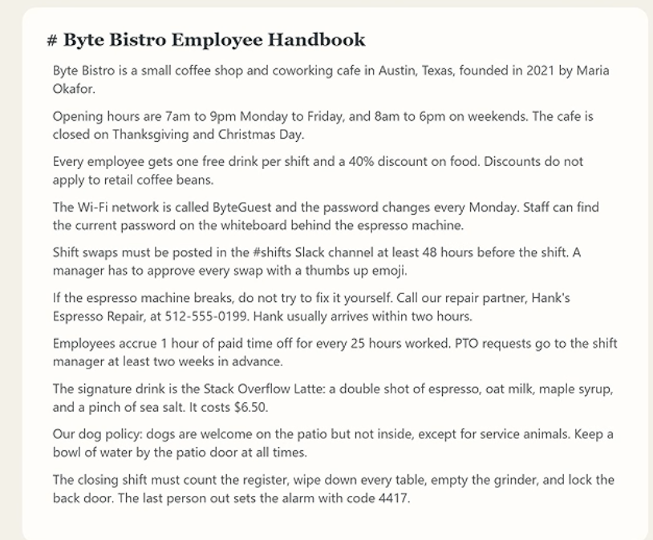
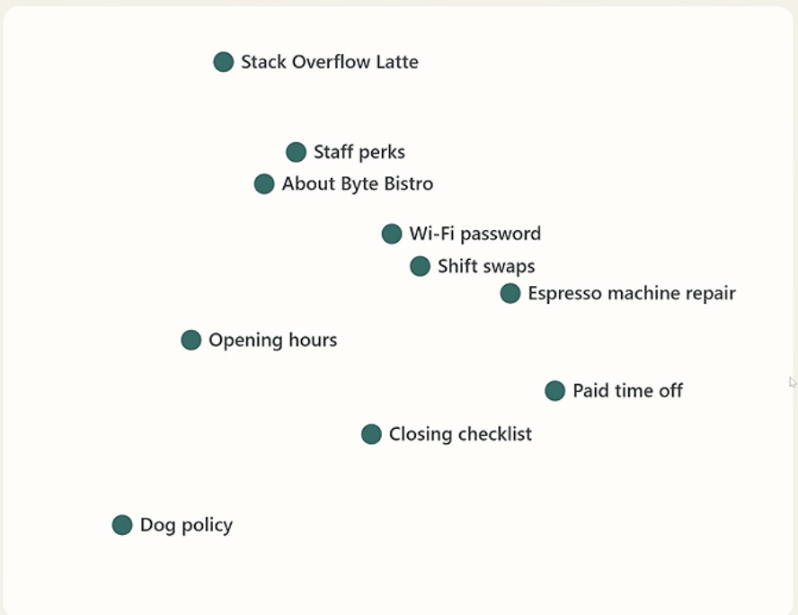
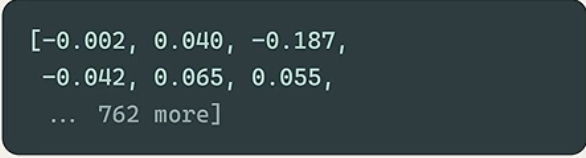
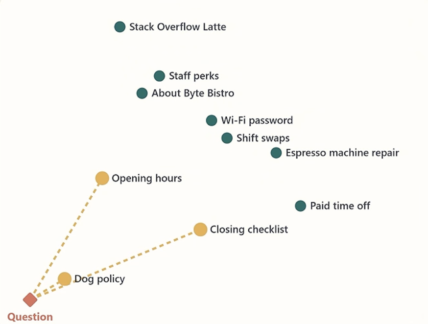
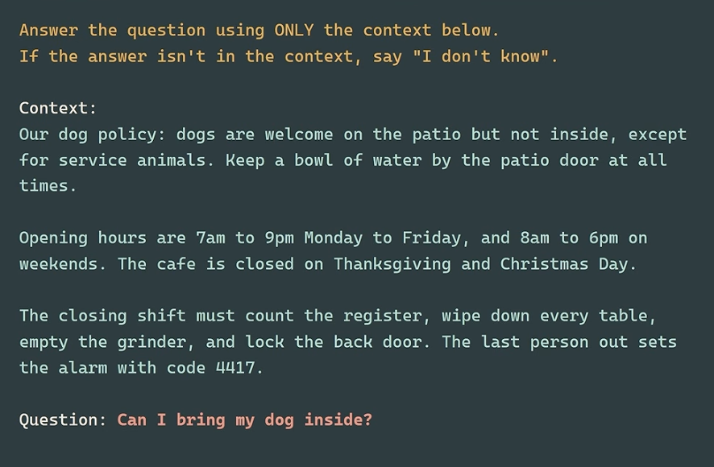

How to Build RAG From Scratch in 50 Lines of Python: https://www.youtube.com/watch?v=f9uAG3AQGWM

Full code: [rag.py in the Coding tab](/coding/rag-from-scratch/)

## How It Works

what happens when you ask a question?

```
1. question: "can I bring my dog inside?"
2. search: look through every chunk of the handbook
3. top 3 chunks: "Dogs are welcome on the patio but not inside..."
4. prompt: question + the chunks we found
5. LLM answer: "No, dogs are only allowed on the patio."
```

### Steps

1. Models

- Get an embedding model and a chat model running locally

2. Chunk

- Split the documents into small pieces

3. Embed

- Turn every chunk into a vector

4. Search

- Find the chunks closest to the question

5. Prompt

- Give those chunks to the LLM and get an answer

## Step 0. The Models

- picking the models

#### Two models are needed:

```python
embedding model: nomic-embed-text # 274MB
chat model: qwen3:4b-instruct # 2.5GB
```

- nomic-embed-text : turns text into numbers to compare meaning
- qwen3:4b-instruct: reads the prompt and writes the answer

commands on terminal

```
 ollama pull nomic-embed-text
 ollama pull qwen3:4b-instruct

```

## Step 1. Chunking

Splitting documents/data into chunks

- A chunk is a small piece of a document.
- Smaller pieces mean a question matches excatly the part it needs.



- `docs/handbook.md` (Byte Bistro Employee Handbook) has one topic per paragraph
- meaning every paragraph becomes its own chunk
- paragraphs are separated by a blank line, so `text.split("\n\n")` splits the document into chunks
- my handbook has 28 chunks = 27 paragraphs + the title of the document
- the example in the image above has 11 chunks = 10 paragraphs + the title

## Step 2. Embedding

Turning every chunk into a vector

- A vector is a list of numbers that describes what a piece of text means
- vectorized or embedded chunks are turned into a bunch of numbers
- numbers then are compared to find related chunks
- so you can pull the relevant information by passing the relevant chunks into the prompt
  
  
- example: a vector for the dog policy chunk
- every dot on the map is one chunk
- similar meaning ends up close together

## Step 3. Similarity Search

Finding the closest chunks

- you turn the question into a vector too
- then score it against every chunk with **cosine simliarity**
- closer to 1 means closer in meaning (cosine similarity checks how much these two arrows point in the same directions)
  

## Step 4. Calling the LLM

context = chunks that found from RAG search

- retreive them
- augment the prompt
- genearte the response



## Plus - What production RAG systems add

A vector database

- pgvector, Chroma, or Pinecone once you have millions of chunks
  Better chunking
- Overlap, headings, and keeping tables and code together
  Reranking
- A second model that re-sorts the top results for accuracy
  Evals
- A set of test questions to measure if changes make answers better or worse

